# 灵光

灵验、显灵、灵光一现……随便咋理解吧，无所谓了！

总之，这是一个想到什么写什么的随缘纯前端项目，不涉及任何后端，所有工具的处理逻辑都在网页上完成，写这些简单功能主要是避免为一个简单的小功能去安装软件到电脑上。

## 效果预览

[首页](#功能模块)

[字体预览](#字体预览)

[JSON格式化](#json格式化)

[颜色转换](#颜色转换)

[Lrc歌词时间轴调整](#lrc歌词时间轴调整)

[进制转换](#进制转换)

[编解码工具](#编解码工具)

[时间戳转换](#时间戳转换)

[文本Diff](#文本Diff)

[UUID生成](#uuid生成)

[哈希计算](#哈希计算)

[单位换算](#单位换算)

[密码生成](#密码生成)

[图片压缩](#图片压缩)

[二维码生成](#二维码生成)

[JWT加解密](#jwt加解密)

## 想在自己本地运行这个项目

自己直接拉取项目然后运行即可，这就是一个普通的vite项目，技术框架：`vite8 + typescript + vue3 + tailwindcss + daisyUI`。

```shell
git clone https://github.com/Triabin/ideasy_front.git
# git clone git@github.com:Triabin/ideasy_front.git
cd ideasy_front
pnpm i
pnpm dev
```

> docker暂时还没时间折腾，不想自己运行可以先试试这个：[https://ideasy.triabin.cn](https://ideasy.triabin.cn/)，如果不卡就直接用它就行了。
> 

## 功能模块

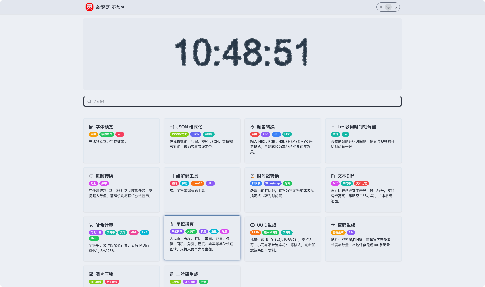

### 字体预览


### JSON格式化

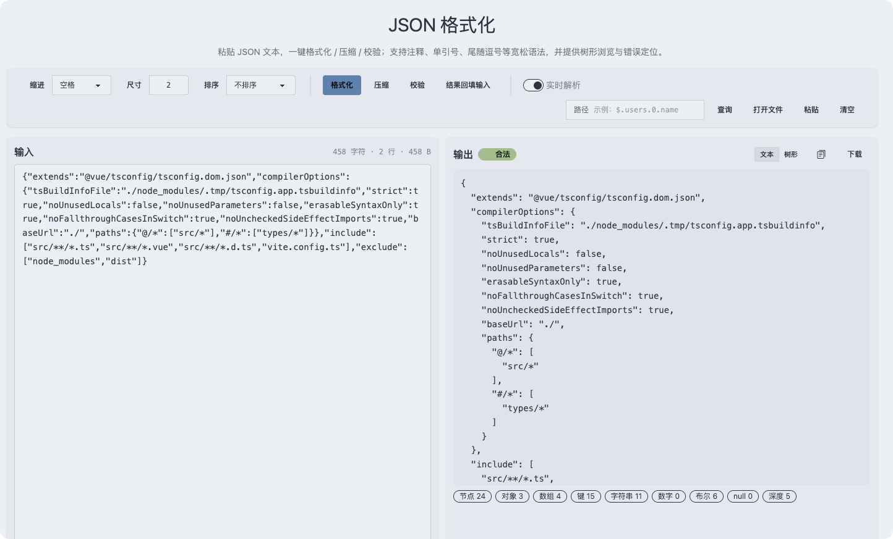

### 颜色转换

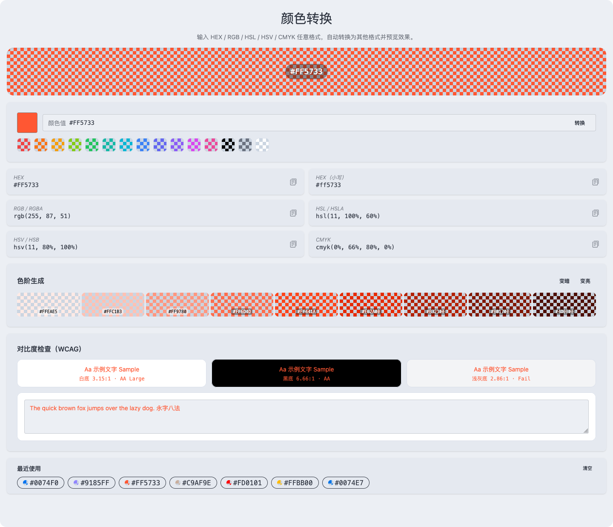

### Lrc歌词时间轴调整

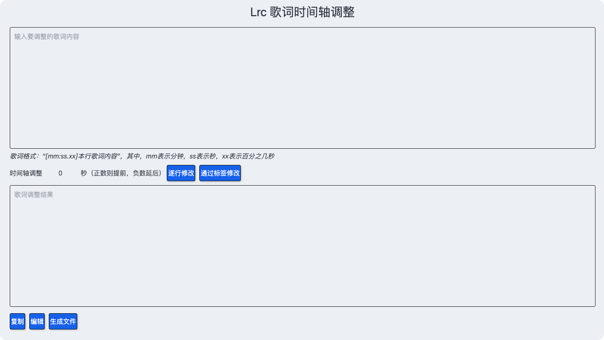

### 进制转换

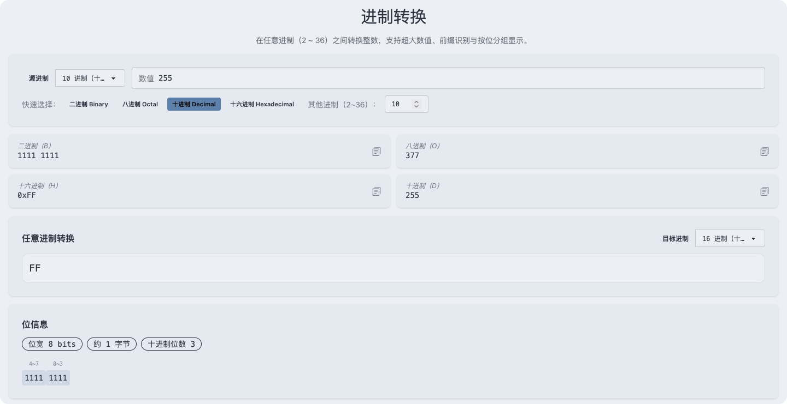

### 编解码工具

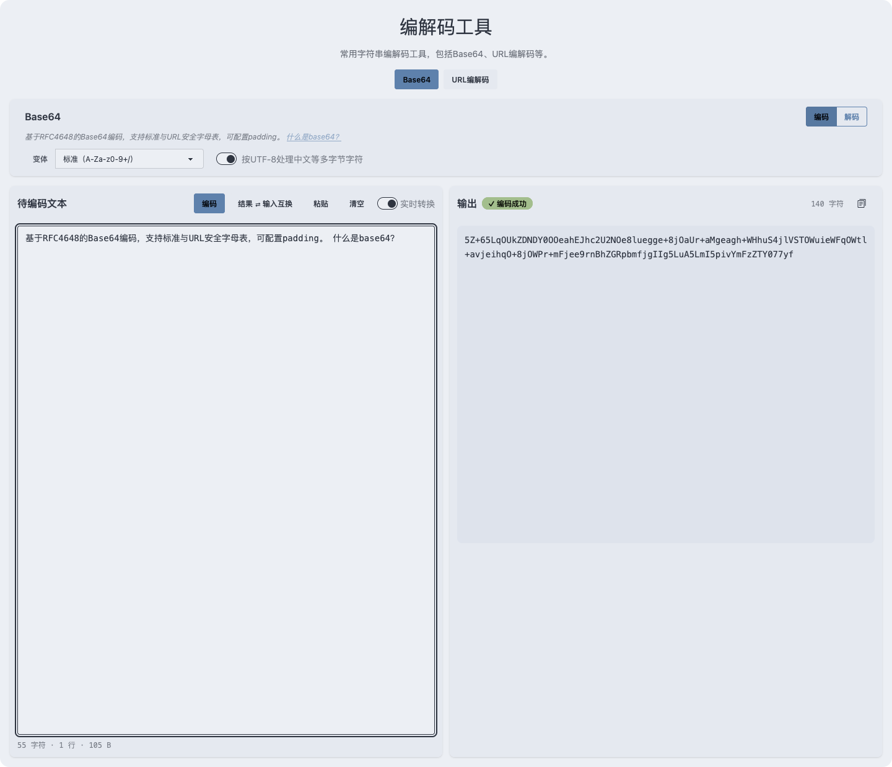

### 时间戳转换

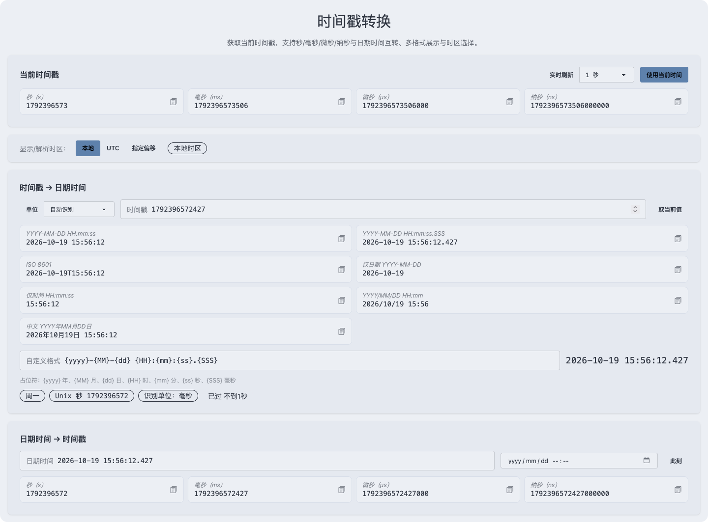

### 文本Diff

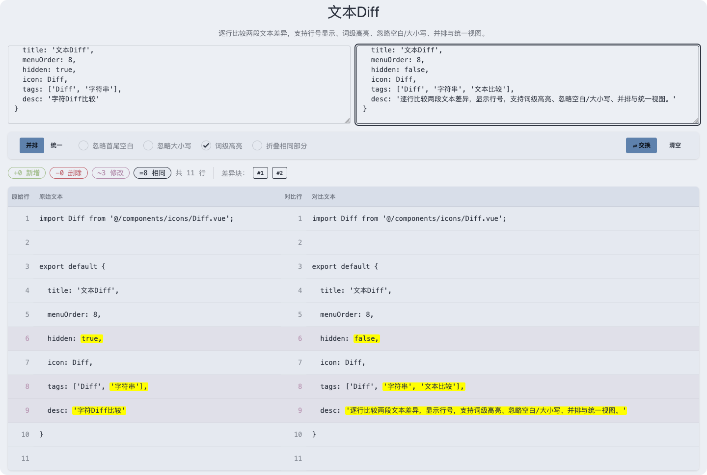

### UUID生成

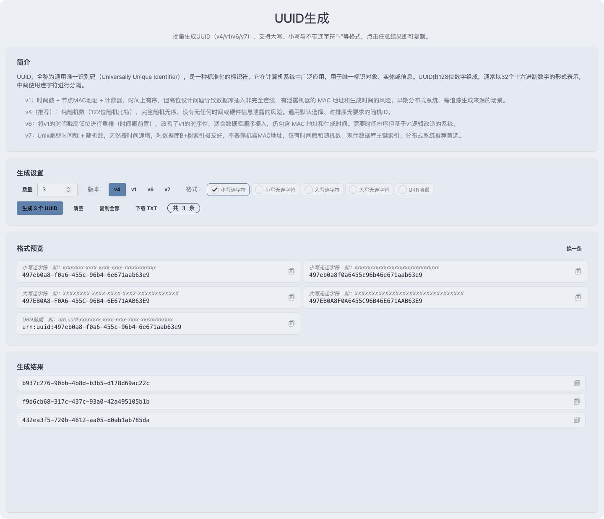

### 哈希计算

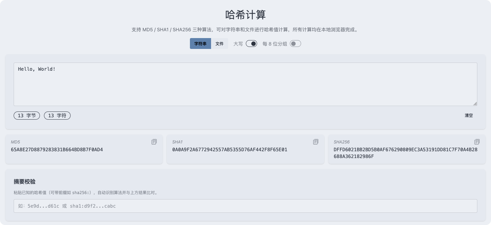

### 单位换算

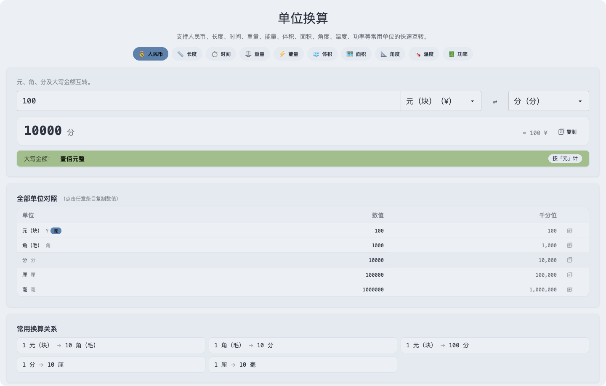

### 密码生成

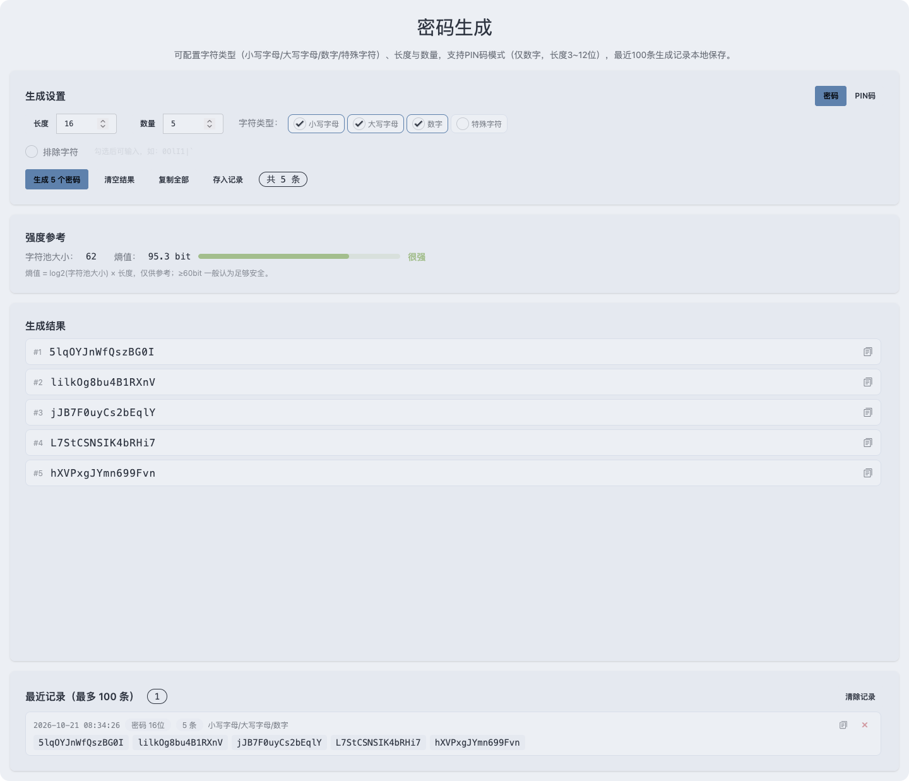

### 图片压缩

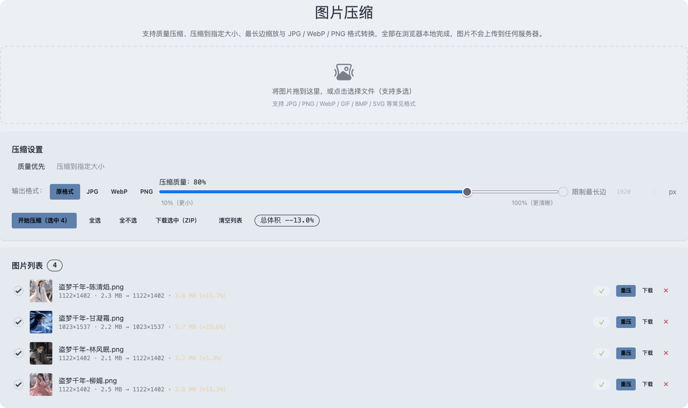

### 二维码生成


### JWT加解密

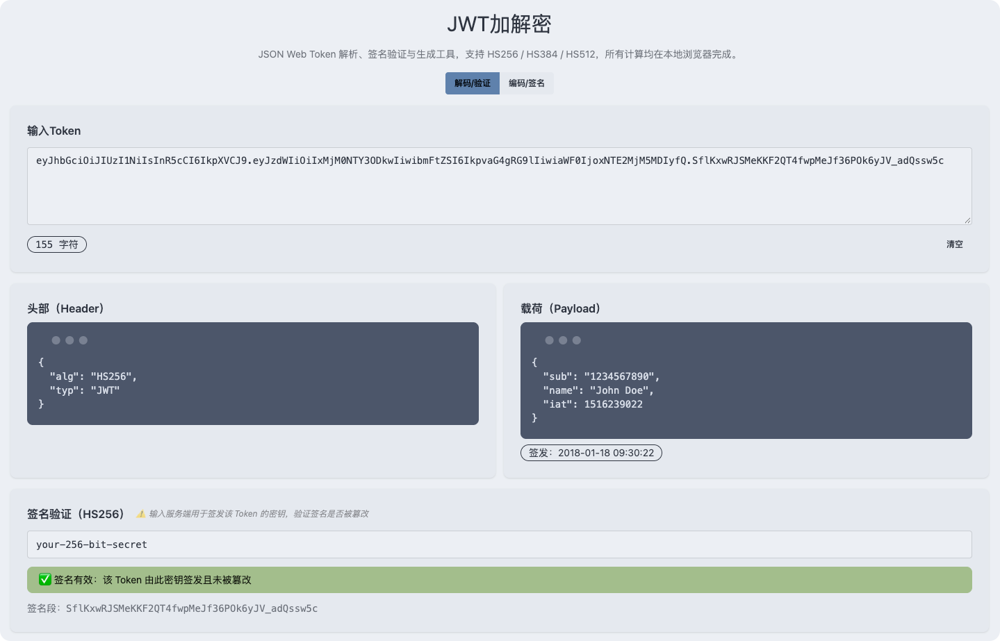
